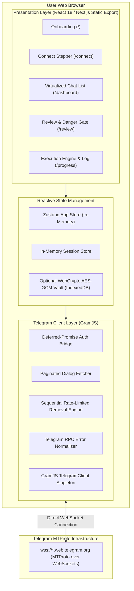
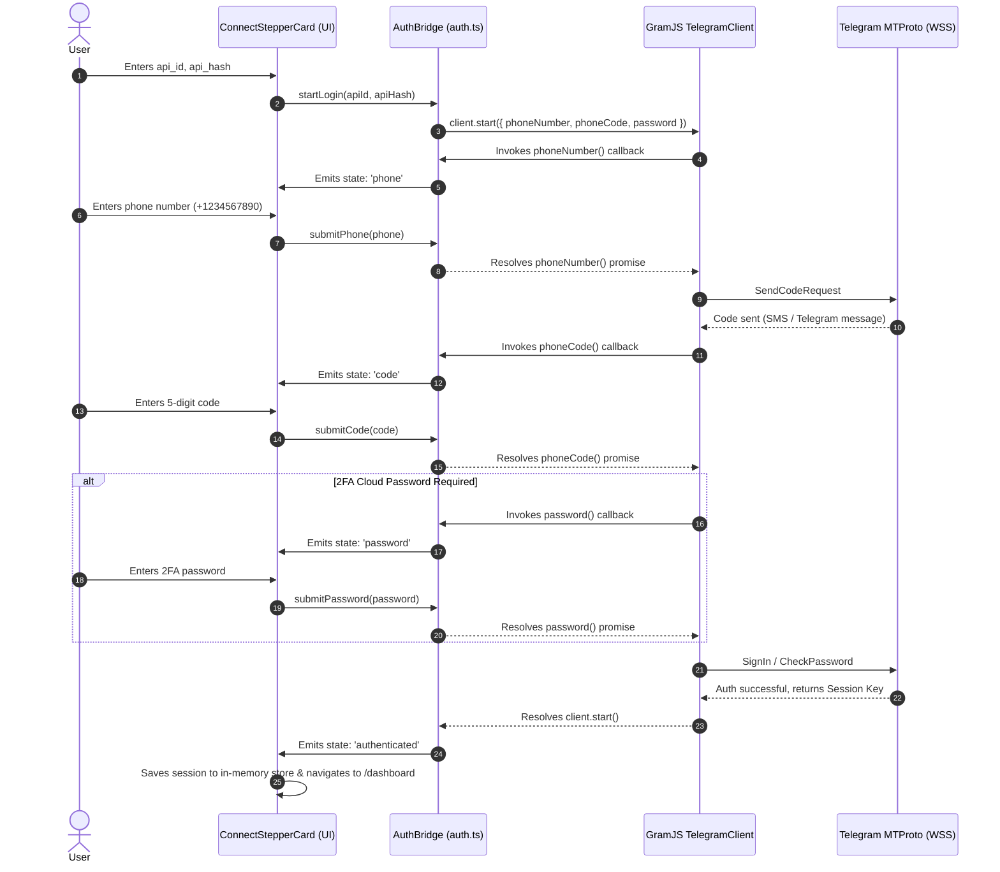

# System Architecture & Flow Specifications

## 1. High-Level Architectural Overview

Telegram Chat Cleaner operates as a pure client-side application served as static files (`output: 'export'`). There are no intermediary servers, API proxies, serverless functions, or analytics collectors.



---

## 2. Authentication Flow (Deferred Promise Stepper Bridge)

Authentication in GramJS uses interactive callback functions (`phoneNumber`, `phoneCode`, `password`). To marry these callbacks to an asynchronous multi-step React UI, `src/lib/telegram/auth.ts` implements a deferred promise bridge:



---

## 3. Removal Engine Flow (Queue, Safety & Flood-Wait Handling)

The removal engine processes chats sequentially to avoid rate-limiting and strictly enforces `revoke: false` so that messages are removed only for the operating account.

```mermaid
flowchart TD
    Start([User confirms on /review with REMOVE]) --> InitQueue[Initialize Queue with Selected Chats]
    InitQueue --> CheckNext{Has More Chats?}

    CheckNext -- No --> Finish[Mark State: Completed -> Show Summary Cards & CSV Download]
    CheckNext -- Yes --> CheckPaused{Is Queue Paused?}

    CheckPaused -- Yes --> WaitResume[Wait for User Resume Event]
    WaitResume --> CheckNext

    CheckPaused -- No --> CheckCancelled{Is Queue Cancelled?}
    CheckCancelled -- Yes --> FinishCancel[Mark State: Cancelled -> Stop Execution]

    CheckCancelled -- No --> FetchNext[Pick Next Chat Item]
    FetchNext --> InspectKind{Chat Kind}

    InspectKind -- Private or Bot --> DelHistory[Api.messages.DeleteHistory<br/>revoke: false, maxId: 2147483647]
    InspectKind -- Basic Group --> DelGroup[Api.messages.DeleteChatUser<br/>userId: 'me', revokeHistory: false<br/>+ DeleteHistory]
    InspectKind -- Supergroup or Channel --> LeaveChan[Api.channels.LeaveChannel<br/>channel: peer]

    DelHistory --> Execute[Execute Request via GramJS]
    DelGroup --> Execute
    LeaveChan --> Execute

    Execute --> SuccessResult{Result?}
    SuccessResult -- Success --> RecordSuccess[Record in Result Stream<br/>Update Progress Counters]
    RecordSuccess --> Delay[Configurable Delay ~400ms]
    Delay --> CheckNext

    SuccessResult -- FloodWaitError --> ReadSeconds[Read flood-wait seconds]
    ReadSeconds --> ShowCountdown[Show Live Flood Countdown to User]
    ShowCountdown --> SleepWait[Async Sleep for Required Seconds]
    SleepWait --> Retry[Retry Same Item (up to 3 retries)]
    Retry --> Execute

    SuccessResult -- Other RPC Error --> CheckRetries{Retries < 3?}
    CheckRetries -- Yes --> Retry
    CheckRetries -- No --> RecordFailed[Record Item as Failed with Error Reason]
    RecordFailed --> Delay
```

---

## 4. Directory & Module Boundaries

| Module | Location | Responsibility & Rules |
| :--- | :--- | :--- |
| **App Routes** | `src/app/` | Static Next.js routes (`/`, `/connect`, `/dashboard`, `/review`, `/progress`). All client components dynamically load GramJS with `ssr: false`. |
| **UI Components** | `src/components/ui/` | Primitives built on Radix UI with standard design tokens (`--primary`, `--surface`, `--text`). |
| **Telegram Client** | `src/lib/telegram/client.ts` | Module-level singleton managing the `TelegramClient` connection over WebSockets. Never exposed to React state directly. |
| **Auth Bridge** | `src/lib/telegram/auth.ts` | Deferred-promise bridge translating UI stepper events to GramJS authentication hooks. |
| **Dialog Fetcher** | `src/lib/telegram/dialogs.ts` | Paginator across active and archived chats. Normalizes chats to uniform `ChatItem` records and enforces protection rules. |
| **Removal Logic** | `src/lib/telegram/removal.ts` | Request builders asserting `revoke: false` for all dialog kinds. |
| **Queue Engine** | `src/lib/telegram/queue.ts` | Sequential execution engine with live subscriber event emitter, pause/resume, abort controller, and flood wait handler. |
| **Session Security** | `src/lib/session/` | In-memory session store, WebCrypto AES-GCM encrypted persistence, and 15-minute inactivity watchdog. |
| **Global Store** | `src/lib/store/` | Zustand in-memory store for chat collections, filter states, and active ID selection. |
